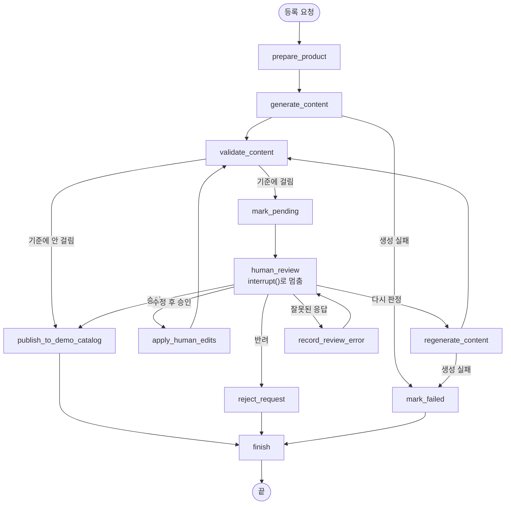

# 스마트 상품 퍼블리셔 (Smart Product Publisher)

상품 정보를 넣으면 AI가 상세페이지 문구를 쓰고, **원본과 다르거나 근거 없는 표현이 있는 건만** 담당자 승인을 받은 뒤 등록하는 사람 승인형(Human-in-the-Loop) 에이전트입니다.

> 실제 쇼핑몰에는 등록하지 않습니다. 최종 반영은 로컬 SQLite의 `demo_catalog` 테이블에 "등록 완료"를 기록하는 것으로 시뮬레이션합니다.

## 1. 해결하려는 문제

상세페이지 문구 작성은 반복 작업이라 AI에게 맡기기 좋습니다. 하지만 AI가 다음처럼 쓰면 고객이 잘못된 정보를 보고 구매합니다.

- 면 100% 상품을 "극세사"라고 쓴다
- 근거 자료에 없는 "항균", "방수", "알레르기 완화"를 덧붙인다
- 할인가·사이즈·구성품을 원본과 다르게 쓴다
- 원본에 없는 세탁 방법을 지어낸다

모든 결과를 사람이 보면 자동화의 의미가 없고, 전부 자동으로 내보내면 이런 오류가 그대로 나갑니다. 이 프로젝트는 **코드로 판단할 수 있는 위험 기준(A~E)** 에 걸린 건만 멈추고, 나머지는 사람 없이 끝까지 처리합니다.

## 2. 주요 기능

- **자동 처리**: 기준에 걸리지 않은 건은 승인 없이 데모 카탈로그에 등록
- **멈춤과 재개**: 위험 건은 등록 직전에 LangGraph `interrupt()`로 멈추고, 담당자 응답을 `Command(resume=...)`로 넣어 멈춘 지점부터 이어서 실행
- **응답 네 가지**: 승인 / 수정 후 승인(수정본을 다시 검증) / 반려(사유 필수) / 다시 판정(지시를 넣어 재생성). 출력 구조 오류나 가격 불일치가 있는 건은 그대로 승인할 수 없음
- **대기 건 보관**: 체크포인트를 SQLite 파일에 저장해서 앱을 껐다 켜도 대기 건과 멈춘 지점이 복구됨
- **반복 상한**: 다시 판정·수정 후 승인은 각각 2회까지. 상한에 닿으면 사유를 적어야 승인할 수 있음(책임 승인)
- **지연 표시**: 3일 넘게 대기한 건은 "지연"으로 표시하고 대기함 맨 위에 둠. 지연 건도 자동 승인하지 않음
- **중복 등록 방지**: 같은 요청을 두 번 승인해도 카탈로그에는 한 번만 등록(`submission_id` 고유 키)
- **기준 검증 화면**: 고정 샘플 20건으로 기준 조합별 개입률·놓침·헛멈춤 비교
- **생성 모드 두 가지**: 키 없이 항상 같은 결과가 나오는 샘플 모드, 로컬 LLM을 쓰는 Ollama 모드

## 3. 기술 스택

| 구분 | 사용한 것 |
|---|---|
| 언어 | Python 3.13 |
| 에이전트 그래프 | LangGraph 1.2.20 (`interrupt`, `Command`, `SqliteSaver`) |
| 체크포인터 | langgraph-checkpoint-sqlite 3.1.3 |
| 웹 화면 | Streamlit 1.67.0 |
| 업무 데이터 | SQLite (파이썬 내장 `sqlite3`) |
| 입력·출력 검증 | Pydantic 2 |
| 로컬 LLM | Ollama + `qwen3.5:2b` (선택) |
| 테스트 | pytest |

## 4. 폴더 구조

```text
smart-product-publisher/
├─ app.py               # Streamlit 시작 파일
├─ ui/                  # 화면 구성 (screens.py: 화면 7개, components.py: 공통 표시 함수)
├─ src/
│  ├─ config.py         # 환경변수, 반복 상한, 지연 일수, 필수 필드 설정
│  ├─ schemas.py        # 상품 입력·생성 결과·그래프 상태의 형태
│  ├─ generation.py     # 샘플 모드 / Ollama 모드 콘텐츠 생성
│  ├─ validation.py     # 승인 기준 A~E, S 검증
│  ├─ nodes.py          # 그래프 단계(생성·검증·승인 대기·등록·반려 등)
│  ├─ graph.py          # 그래프 연결과 SQLite 체크포인터
│  ├─ service.py        # 화면이 부르는 기능(등록 요청, 응답, 목록 조회)
│  ├─ database.py       # 업무 DB 연결과 테이블 생성
│  ├─ repository.py     # 요청·이력·카탈로그 저장과 조회
│  ├─ sample_data.py    # 고정 샘플 20건과 정답 라벨
│  ├─ metrics.py        # 개입률·놓침·헛멈춤 계산
│  └─ eval_data/        # 로컬 LLM 실제 출력과 정답 라벨 (평가용 40건)
├─ tests/               # pytest 테스트
├─ data/                # 실행하면 app.db, checkpoints.db가 생김 (깃에 올리지 않음)
├─ docs/screenshots/    # 보고서용 화면 캡처
├─ .streamlit/config.toml
├─ requirements.txt
├─ .env.example
├─ README.md
└─ REPORT.md
```

## 5. 설치와 실행

### 5-1. 리눅스 / WSL (실행을 확인한 환경)

개발과 테스트는 Windows 11의 WSL2(Ubuntu) + Python 3.13에서 했습니다.

```bash
python3 --version          # 3.11 이상인지 확인
python3 -m venv .venv
source .venv/bin/activate
pip install -r requirements.txt
cp .env.example .env
streamlit run app.py
```

브라우저에서 `http://localhost:8501`이 열립니다. WSL에서 실행해도 윈도우 브라우저로 같은 주소를 열면 됩니다.

[uv](https://docs.astral.sh/uv/)를 쓴다면 다음처럼 해도 됩니다.

```bash
uv venv .venv --python 3.13
source .venv/bin/activate
uv pip install -r requirements.txt
```

### 5-2. Windows PowerShell

```powershell
py --version
py -m venv .venv
.venv\Scripts\Activate.ps1
pip install -r requirements.txt
Copy-Item .env.example .env
streamlit run app.py
```

> **주의**: Windows 11의 "스마트 앱 컨트롤"이 켜져 있으면 `ormsgpack`, `pandas`, `pyarrow` 같은 패키지의 DLL을 막아 `DLL load failed ... 애플리케이션 제어 정책` 오류가 날 수 있습니다. 개발한 PC가 이 경우였고, 보안 설정은 바꾸지 않고 WSL에서 실행했습니다. 같은 오류가 나면 5-1의 WSL 방법을 쓰세요.

### 5-3. 테스트

```bash
pytest -q
```

테스트는 임시 폴더에 DB를 만들기 때문에 `data/`의 실제 데이터를 건드리지 않습니다. Ollama 서버가 없어도 통과합니다(Ollama 호출은 가짜 응답으로 대신함).

### 5-4. 승인 기준 비교표 출력

```bash
python -m src.metrics
```

고정 샘플 20건, 저장된 LLM 실제 출력 20건, 처음 보는 LLM 출력 20건에 대해 기준 조합별 개입률·놓침·헛멈춤을 출력합니다. LLM을 다시 부르지 않고 저장된 출력(`src/eval_data/`)을 검증하므로 몇 번을 실행해도 같은 결과가 나옵니다.

## 6. `.env` 설정

`.env.example`을 복사해 `.env`를 만듭니다. 이 프로젝트는 **API 키가 필요 없습니다**.

| 이름 | 기본값 | 설명 |
|---|---|---|
| `GENERATION_MODE` | `sample` | 등록 화면의 기본 생성 방식 |
| `OLLAMA_BASE_URL` | `http://localhost:11434` | Ollama 서버 주소 |
| `OLLAMA_MODEL` | `qwen3.5:2b` | 사용할 모델 |
| `OLLAMA_TIMEOUT_SECONDS` | `180` | 한 건 생성 제한 시간 |
| `SPP_DATA_DIR` | `data` | DB 파일을 둘 폴더 |

`.env`는 `.gitignore`에 들어 있어 저장소에 올라가지 않습니다. 나중에 외부 API를 붙이더라도 키는 `.env`에만 두세요.

## 7. 생성 모드

### 샘플 모드 (기본)

- 원본 필드만으로 문구를 만드는 템플릿에, 샘플마다 정해 둔 "위험 문구"를 덧붙입니다.
- 같은 샘플은 항상 같은 결과가 나와서 기준 검증과 시연을 그대로 재현할 수 있습니다.
- 직접 입력한 상품은 "데모용 위험 문구"(소재 바꿔 쓰기, 항균·방수 추가, 할인가 다르게, 킹 사이즈 추가)를 골라 주입할 수 있습니다.
- "다시 판정"을 하면 위험 문구 없이 원본 정보만으로 다시 씁니다.

### Ollama 모드 (선택)

로컬 LLM이 원본 상품 정보를 보고 직접 문구를 씁니다. 결과는 반드시 같은 검증 단계를 거치고, LLM이 "문제없다"고 해도 그것만으로 등록하지 않습니다.

```bash
ollama pull qwen3.5:2b
ollama serve
```

등록 화면에서 생성 방식을 "Ollama"로 고르면 됩니다. 서버가 꺼져 있거나 응답이 형식에 맞지 않으면 그 요청은 "처리 실패"로 기록되고 등록되지 않습니다. 이때는 샘플 모드로 바꿔 다시 시도하세요. CPU에서 2B 모델은 한 건에 10~30초 정도 걸렸습니다.

## 8. 사용 방법 (시연 순서)

1. **대시보드**에서 "샘플 전체 실행"을 누릅니다. 샘플 20건 중 9건은 자동 등록, 11건은 승인 대기로 들어갑니다.
2. **승인 대기함**에서 한 건의 "상세 보기"를 엽니다.
3. **승인 상세**에서 요청 원문, AI 생성 결과, 검증 근거(원본 값과 AI가 쓴 값 비교), 멈춘 이유, 승인 시 결과를 확인하고 응답합니다.
   - 예: S02(극세사) → "수정 후 승인"으로 한 줄 요약만 고치면, 상세 설명에 남은 "극세사" 때문에 다시 대기합니다. 상세 설명까지 고치면 재검증을 통과해 등록됩니다.
4. **데모 카탈로그**에서 등록된 콘텐츠와 등록 방식(자동 / 사람 승인)을 확인합니다.
5. **처리 이력**에서 요청마다 생성 → 검증 → 승인 대기 → 응답 → 등록 과정을 봅니다.
6. **승인 기준 검증**에서 기준 조합별 개입률·놓침·헛멈춤을 비교합니다.
7. 대기 건이 남은 상태에서 터미널의 Streamlit을 껐다(`Ctrl+C`) 다시 실행하면, 대기 건이 그대로 남아 있고 이어서 처리할 수 있습니다.

## 9. 승인·재개 흐름



- 요청마다 고유한 `thread_id`가 있고, 체크포인트는 `thread_id`별로 따로 저장됩니다.
- `human_review` 단계는 재개될 때 첫 줄부터 다시 실행되기 때문에, 이 단계 안에서는 DB 기록 같은 바깥 작업을 하지 않습니다. 대기 상태 기록은 바로 앞의 `mark_pending` 단계가 합니다.
- 등록(`publish_to_demo_catalog`)은 `INSERT OR IGNORE`라 다시 실행돼도 중복 등록되지 않습니다.

## 10. 데이터 저장 위치와 초기화

| 파일 | 내용 |
|---|---|
| `data/app.db` | 요청(`submissions`), 처리 이력(`review_events`), 데모 카탈로그(`demo_catalog`) |
| `data/checkpoints.db` | LangGraph 체크포인트(멈춘 지점과 그때의 상태) |

처음 상태로 돌리려면 Streamlit을 끄고 두 파일을 지웁니다.

```bash
rm -f data/*.db data/*.db-*
```

## 11. 알려진 제한 사항

- 위험 판단은 단어 사전과 정규식 기반입니다. 사전에 없는 바꿔 말하기(예: "세균 걱정 없는", "물이 스며들지 않는", "피부를 자극하지 않도록")는 놓칩니다. 최종 기준(A~E)도 고정 샘플 20건 중 2건, 처음 보는 LLM 출력 20건 중 2건을 놓쳤습니다(자세한 내용은 REPORT.md).
- 주의 문장("알레르기가 있으신 분은 확인해 주세요")이나 수식어("숙면과 편안함을 위한")도 효능 주장으로 보고 멈출 수 있습니다.
- 원본 상품 정보 자체가 틀렸는지는 검사하지 않습니다.
- Ollama 모드는 결과가 매번 달라서 평가 수치는 샘플 모드로만 냅니다.
- 화면은 담당자 한 명이 쓰는 로컬 데모입니다. 로그인·권한 관리, 여러 서버 동시 사용은 하지 않습니다.
- Windows에서 스마트 앱 컨트롤이 켜져 있으면 패키지가 막힐 수 있습니다(5-2 참고).
