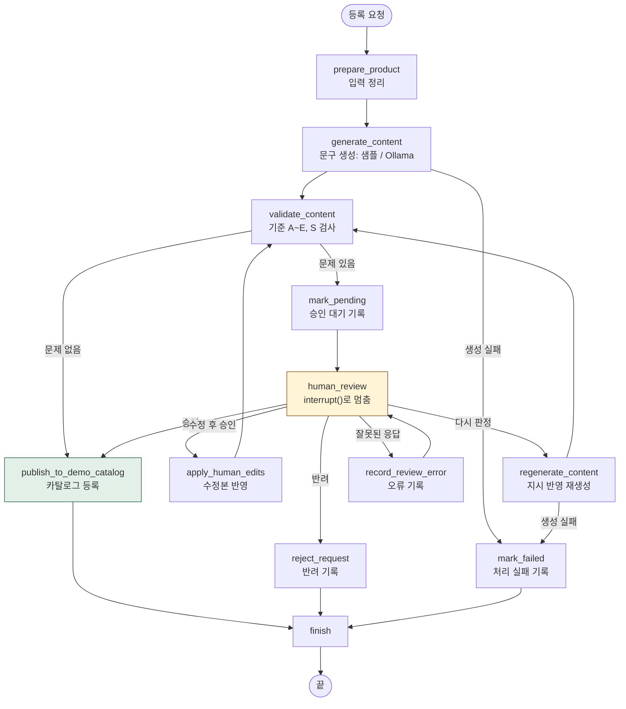
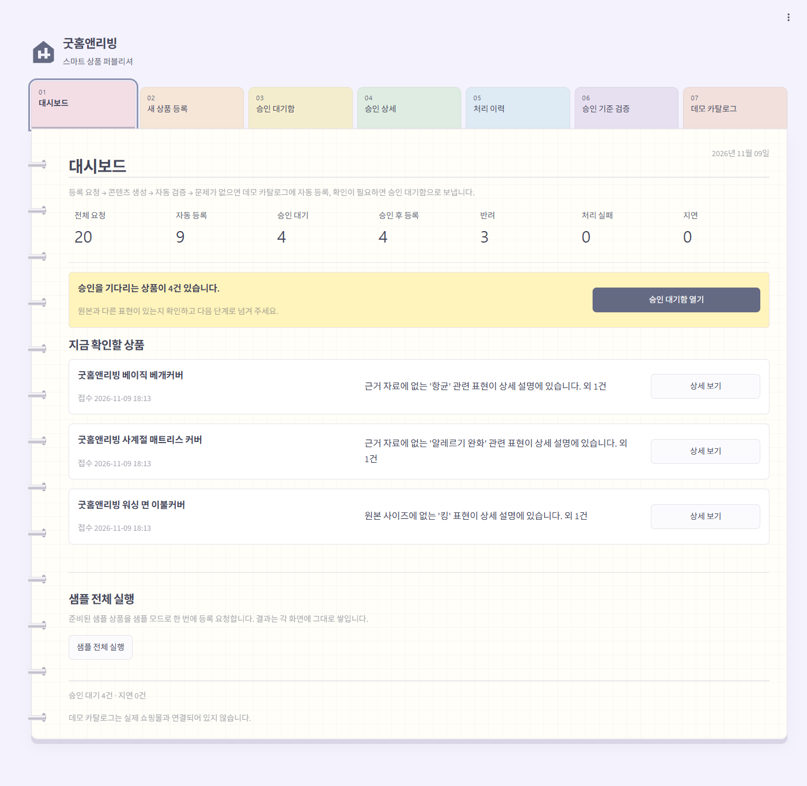
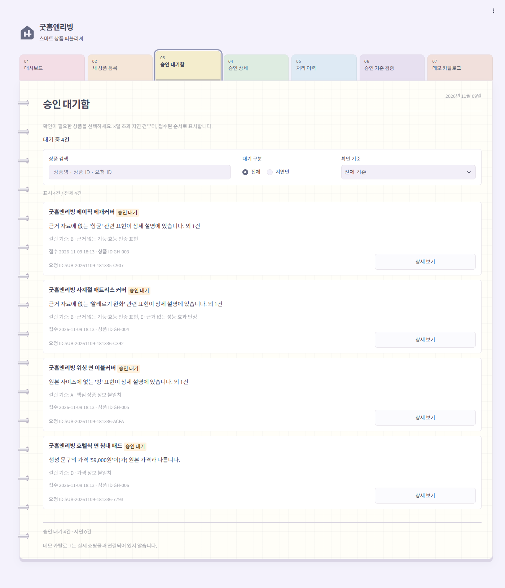
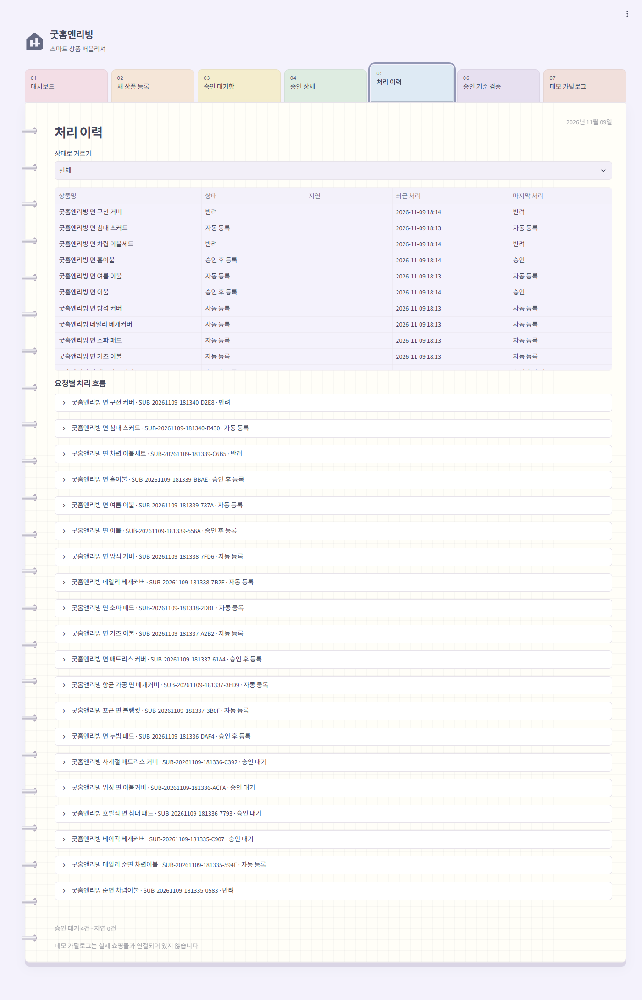
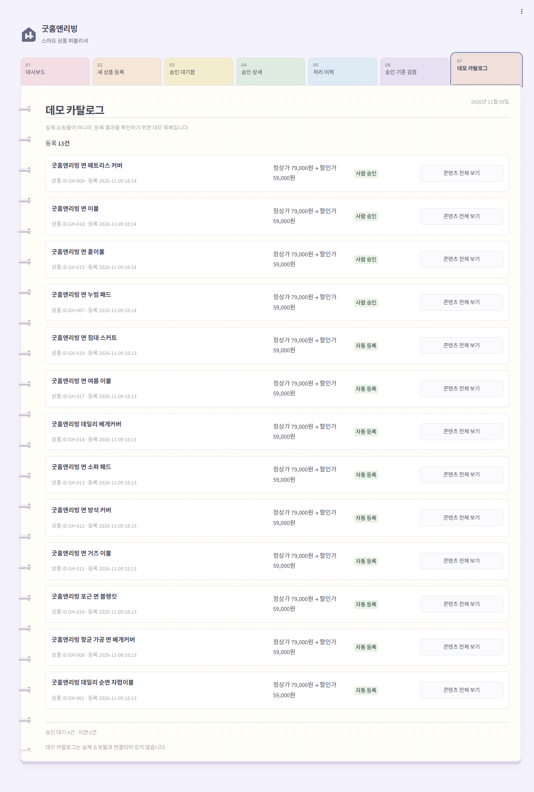
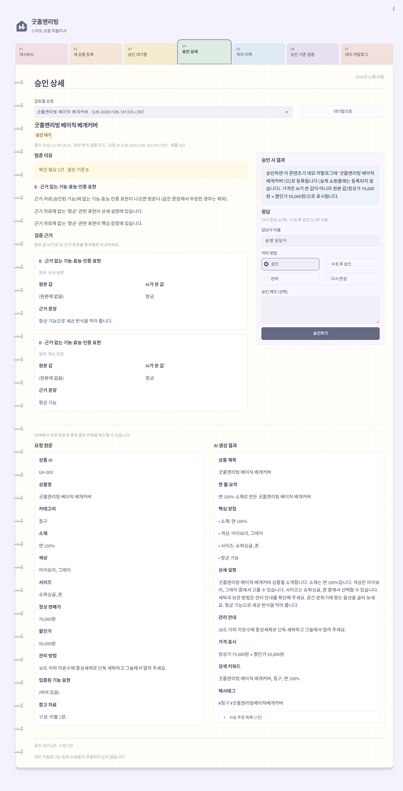
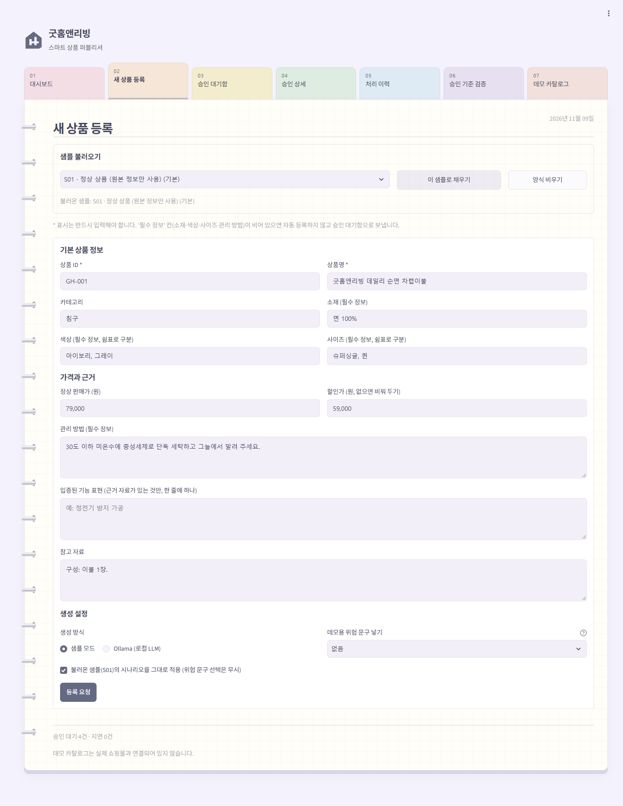
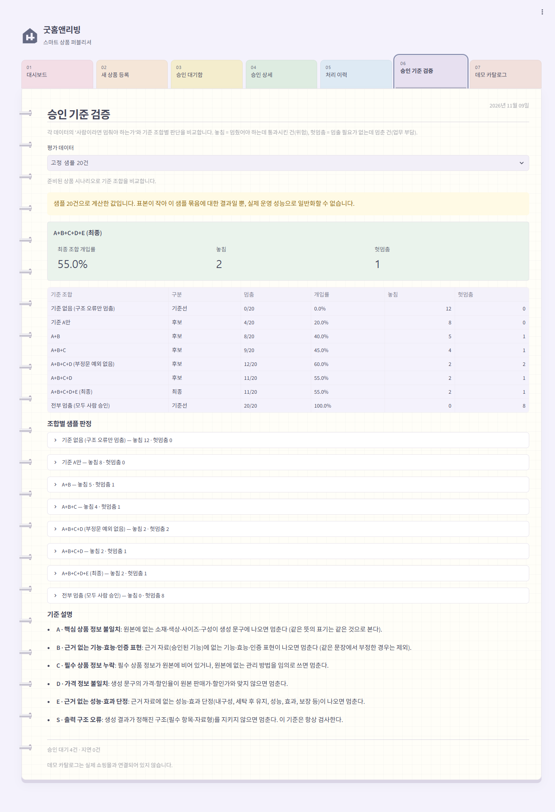

# REPORT — 스마트 상품 퍼블리셔

사람이 승인하는 이커머스 상세페이지 콘텐츠 등록 에이전트의 설계와 결과를 정리한다.

## 1. 주제와 고른 이유

### 자동화한 업무

리빙 브랜드 "굿홈앤리빙"(가상)의 **상품 상세페이지 콘텐츠 작성·등록**이다. 담당자가 상품 정보(소재, 색상, 사이즈, 가격, 관리 방법, 근거 자료로 입증된 기능)를 넣으면 에이전트가 제목, 한 줄 요약, 핵심 장점, 상세 설명, 관리 안내, 검색 키워드를 쓰고 카탈로그에 등록한다.

### 반복 작업과 오류 위험

상세페이지 문구는 상품마다 비슷한 구조로 반복해서 쓰기 때문에 AI에게 맡기기 좋다. 하지만 AI가 쓴 문장은 다음처럼 틀릴 수 있다.

- 소재·색상·사이즈·구성품을 원본과 다르게 쓴다 (면 100% → 극세사)
- 입증되지 않은 기능·효능을 덧붙인다 (항균, 방수, 알레르기 완화, 피부 자극 없음, 숙면)
- 할인가·할인율을 틀리게 쓴다
- 원본에 없는 관리 방법을 지어낸다

실제로 로컬 LLM(qwen3.5:2b)에게 원본 정보만 주고 20건을 쓰게 했더니 **16건에 원본에 없는 내용이 들어갔다**(효능·성능 표현 15건, 지어낸 관리 방법 1건, 4장 참고). 이런 문장이 고객에게 노출되면 잘못된 정보로 구매가 일어나고, 효능 표현은 표시·광고 문제로 이어질 수 있다.

### 결과가 바깥으로 나가는 단계

**카탈로그 등록(`publish_to_demo_catalog`)** 이다. 등록되는 순간 고객이 그 문구를 보게 되고, 이미 본 고객의 판단은 되돌릴 수 없다. 그 앞의 생성·검증은 몇 번을 다시 해도 괜찮다. 그래서 사람의 승인 단계는 **등록 바로 앞**에 두었다.

### 실제 쇼핑몰 대신 로컬 데모 카탈로그를 쓴 이유

- 데모를 실행할 때마다 실제 상품이 등록되면 안 된다.
- 쇼핑몰 API 연동은 HITL 구조와 상관없는 인증·형식 문제가 커서 핵심을 흐린다.
- 등록을 SQLite의 `demo_catalog`에 기록하는 것으로 바꿔도 "되돌릴 수 없는 마지막 단계"라는 구조는 똑같이 보여 줄 수 있다. 실제 연동 때는 이 단계 하나만 쇼핑몰 API 호출로 바꾸면 된다.

## 2. 파이프라인 구조도

### 단계와 흐름

- **자동 처리 경로**: `prepare → generate → validate → publish → finish`. 사람을 한 번도 거치지 않는다.
- **승인 대기 경로**: `validate`에서 문제가 나오면 `mark_pending → human_review`에서 멈춘다.
- **멈추는 지점**: `human_review` 안의 `interrupt(payload)`. `payload`가 곧 승인 화면의 내용이다.
- **재개 경로**: 담당자 응답을 `Command(resume=응답)`으로 같은 `thread_id`에 넣으면 `human_review`부터 이어서 실행되고, 응답의 `action`에 따라 갈라진다.

### 상태(State)

| 키 | 내용 |
|---|---|
| `submission_id`, `thread_id` | 요청 ID, 재개용 스레드 ID (요청마다 하나) |
| `product_input` | 원본 상품 정보 |
| `generation_mode` | `sample` 또는 `ollama` |
| `generated_content` | AI가 쓴 콘텐츠 |
| `validation_flags` | 검증에서 나온 문제 목록 (기준, 원본 값, AI가 쓴 값, 근거 문장) |
| `review_response` | 담당자 응답 (승인 화면 내용은 상태에 따로 두지 않고 `interrupt()` 값으로 전달) |
| `regeneration_count`, `edit_round` | 다시 판정·수정 후 승인 횟수 (각 2회 상한) |
| `final_content` | 등록된 최종 콘텐츠 (가격은 원본에서 다시 채움) |
| `processing_route` | `auto` 또는 `human` |
| `status` | `processing` → `auto_published` / `pending_review` / `approved_published` / `rejected` / `failed` |

### 구조를 짤 때 지킨 원칙

1. **멈추는 단계 안에서는 바깥 작업을 하지 않는다.** `human_review`는 재개될 때 첫 줄부터 다시 실행된다. 그래서 DB에 "승인 대기"를 쓰는 일은 바로 앞의 `mark_pending` 단계로 뺐다. 테스트로 재개 전후의 이력 건수와 카탈로그 건수가 늘지 않는 것을 확인했다.
2. **체크포인터는 파일에 둔다.** `SqliteSaver`로 `data/checkpoints.db`에 저장한다. 앱을 꺼도 멈춘 지점과 그때의 상태가 남는다.
3. **등록은 한 번만 일어나게 한다.** `demo_catalog.submission_id`가 고유 키이고 `INSERT OR IGNORE`로 넣는다. 서비스 층에서도 상태가 `pending_review`가 아니면 응답을 받지 않는다.
4. **가격은 AI에게 맡기지 않는다.** 최종 콘텐츠의 가격 표시는 원본 판매가·할인가로 다시 만든다. 본문 속 가격 문구가 원본과 다르면(D) '그대로 승인'을 막는다.
5. **수정본도 다시 검증한다.** "수정 후 승인"을 눌러도 바로 등록하지 않고 `validate_content`로 돌아간다. 여전히 문제가 있으면 다시 멈춘다.

## 3. 승인 기준과 그 이유

### 기준 목록

다섯 기준 중 하나라도 걸리면 멈춘다. 모두 "이상해 보이면"이 아니라 코드로 계산하는 조건이다.

| 기준 | 계산 조건 | 대비하려는 위험 |
|---|---|---|
| **A. 핵심 정보 불일치** | 생성 문장(제목·요약·장점·설명·관리 안내·키워드)과 사실 주장 목록에 나온 소재·색상·사이즈 단어가 원본 값에 없으면 멈춤. "N장/N종 포함" 같은 구성 표현이 원본 메모에 없으면 멈춤. 같은 뜻의 표기(면 100% = 순면 = 코튼 100%)는 같게 보고, 뜻이 다른 것(슈퍼싱글 ≠ 싱글, 혼방 ≠ 순면)은 다르게 본다. | 고객이 실제와 다른 상품을 보고 구매 |
| **B. 근거 없는 기능·효능·인증** | 항균, 진드기, 알레르기, 아토피, 방수, 발수, 오염 방지, 탈취, 친환경, KC·OEKO-TEX 인증, 숙면·수면의 질, 피부 자극, 유해물질, 건강·성능 효능 등 19개 표현 묶음이 나오는데 원본의 "입증된 기능" 목록에 없으면 멈춤. 같은 문장에서 부정한 경우("방수 기능은 없습니다")는 제외. 단, "줄지 않습니다", "벗겨지지 않아요"처럼 기능이 오래간다는 말은 부정으로 보지 않는다. 승인된 기능이 같은 문장에 있어도, 그 기능의 키워드가 아닌 다른 기능은 따로 검사한다. | 입증되지 않은 효능 광고 |
| **C. 필수 정보 누락** | 소재·색상·사이즈·관리 방법 중 원본에 빈 칸이 있거나, 원본에 없는 관리 방법을 AI가 지어내면 멈춤. 카테고리별로 필수 필드를 설정에서 바꿀 수 있다. | 구매 전에 알아야 할 정보가 빠지거나 지어낸 관리법으로 제품 손상 |
| **D. 가격 불일치** | 문장 속 가격("59,000원", "5만 9천원", "6만 원대")과 할인율("25% 할인")이 원본 판매가·할인가와 맞지 않으면 멈춤. 원본에 가격이 없는데 문장에 가격이 있어도 멈춤. | 잘못된 판매가·할인가 노출 |
| **E. 근거 없는 성능·효과 단정** | 내구성, 수명, 성능, 효과, 보장, 해소·개선, 세정력, "세탁 후에도 … 유지", "변하지 않", "밀리지 않", 보습 같은 단정이 원본 근거 자료에 없으면 멈춤. | 이름 없는 성능 과장(B가 못 잡는 영역). "내구성 시험은 하지 않았음"처럼 원본 메모가 부정한 경우는 근거로 인정하지 않는다. |
| **S. 출력 구조 오류** (항상 검사) | 생성 결과가 정해진 항목·자료형을 지키지 않으면 멈춤. | 깨진 결과가 그대로 등록 |

검증은 LLM의 자기 평가를 쓰지 않는다. LLM이 스스로 적어 내는 사실 주장 목록(`fact_claims`)만 믿지도 않는다. 본문에는 "극세사"라고 쓰고 사실 주장 목록에서는 빼는 경우가 있기 때문이다(샘플 S02가 이 경우다). 그래서 실제 생성 문장 전체를 문장 단위로 검사한다.

### 자동으로 처리되는 건과, 사람이 보지 않아도 되는 이유

자동 처리 예시는 다음과 같다.

- S01: 원본 정보만 다시 쓴 정상 문구
- S08: "항균 가공 원단 사용"이 시험성적서로 입증된 기능 목록에 있는 상품
- S10, S19: "포근한", "호텔 같은"처럼 분위기만 표현한 문구
- S14: "순면"과 "면 100%"처럼 같은 뜻을 다르게 쓴 문구
- S17: 원본 가격에서 계산한 정확한 "25% 할인"

이런 건을 사람이 보지 않아도 되는 근거는 세 가지다.

1. **고객이 확인할 수 있는 사실은 모두 원본과 대조를 통과했다.** 소재·색상·사이즈·구성(A), 가격·할인율(D)은 원본과 맞는다. 가격 필드는 아예 원본에서 다시 채운다.
2. **입증이 필요한 주장은 근거가 있는 것만 남았다.** 기능·효능·성능 표현(B, E)은 "입증된 기능" 목록에 있는 것만 통과한다. 이 목록은 시험성적서 같은 근거 자료가 있을 때만 채우도록 입력 화면에서 안내한다.
3. **남는 위험의 크기를 쟀다.** 사전에 없는 바꿔 말하기는 여전히 빠져나간다. 그 비율은 고정 샘플 20건 중 2건, 처음 보는 LLM 출력 20건 중 2건이었다(4장). 이 정도의 남은 위험은 사람이 전부 보는 비용(20건 모두 검토)보다 작다고 판단했다. 대신 운영에서는 자동 등록 건 일부를 정기적으로 뽑아 사후 점검하는 것을 함께 두는 것이 맞다(6장 회고).

"자동 통과"는 "사람이 절대 볼 필요가 없다"는 뜻이 아니다. 이 프로젝트에서 정한 위험 기준에 해당하지 않았다는 뜻이다.

### 운영 규칙

- **반복 상한**: "다시 판정"과 "수정 후 승인"은 각각 2회까지 쓸 수 있다. 상한에 닿으면 그 버튼이 사라지고, "승인"에는 사유를 꼭 적어야 한다(책임 승인). 담당자가 끝없이 고치기만 하다 결정이 미뤄지는 것을 막기 위해서다.
- **3일 넘은 대기 건**: "지연"으로 표시하고 대기함 맨 위, 대시보드 경고에 올린다. **자동 승인은 하지 않는다**. 자동 승인은 이 시스템이 막으려는 위험을 그대로 통과시키는 것이기 때문이다. 자동 반려도 하지 않는다. 대부분 문구 한두 곳만 고치면 되는 건이라 버리면 판매 기회와 재작업 비용이 더 크다. 대신 눈에 띄게 올려서 사람이 결정하게 한다.
- **반려 사유 필수**: 사유를 받아야 나중에 왜 막았는지 추적할 수 있고, 기준을 고칠 재료가 된다.
- **구조 오류(S)나 가격 불일치(D)가 있으면 그대로 승인할 수 없다**: 깨진 결과는 게시할 수 없다. 가격은 게시 때 가격 표시 칸을 원본 값으로 바꾸지만, 본문 문장 속 틀린 가격은 그대로 남는다. 그래서 수정하거나 다시 판정해야 한다.

## 4. 기준 검증 결과

### 평가 데이터

| 데이터 | 건수 | 만든 방법 |
|---|---|---|
| 고정 샘플 (`src/sample_data.py`) | 20 | 원본 문구에 위험 문구를 정해진 대로 덧붙인 결정론적 샘플. 기본 10건 + 규칙이 틀리도록 일부러 만든 **함정 10건**(바꿔 말하기, 부정문, 같은 뜻 다른 표기, 어림한 가격, 주의 문장 등) |
| LLM 출력 A (`src/eval_data/llm_replay.json`) | 20 | 로컬 LLM이 원본 정보만 보고 실제로 쓴 문구. 문구를 직접 읽고 정답을 붙였다. **기준 E를 만들 때 참고했다.** |
| LLM 출력 B (`src/eval_data/llm_holdout.json`) | 20 | 기준을 고친 뒤 같은 상품을 다른 시드로 다시 생성한 문구. **규칙을 돌리기 전에** 정답을 먼저 붙였다. 처음 보는 데이터다. |

정답(`expected_review`)은 "꼼꼼한 검수자라면 사람이 확인해야 한다고 볼 것인가"로 붙였다. 규칙 결과에 맞추지 않았다. 애매한 건은 이유에 그렇게 적었다.

### 고정 샘플 20건

| 기준 조합 | 멈춤 | 개입률 | 놓침 | 헛멈춤 |
|---|---:|---:|---|---|
| 기준 없음 (기준선) | 0/20 | 0% | 12 | 0 |
| A만 | 4/20 | 20% | 8 | 0 |
| A+B | 8/20 | 40% | 5 | 1 (S20) |
| A+B+C | 9/20 | 45% | 4 | 1 (S20) |
| A+B+C+D, 부정문 예외 없음 | 12/20 | 60% | 2 (S11, S12) | 2 (S13, S20) |
| A+B+C+D | 11/20 | 55% | 2 (S11, S12) | 1 (S20) |
| **A+B+C+D+E (최종)** | **11/20** | **55%** | **2 (S11, S12)** | **1 (S20)** |
| 전부 멈춤 (기준선) | 20/20 | 100% | 0 | 8 |

- 기준을 하나씩 더할 때마다 놓침이 12 → 8 → 5 → 4 → 2로 줄었다. 각 기준이 서로 다른 위험을 잡는다는 뜻이다. A는 소재·사이즈·색상, B는 효능, C는 관리 방법 누락, D는 가격을 잡았다.
- **부정문 예외**는 헛멈춤을 2건에서 1건으로 줄였다. "방수 기능은 없으니 비 오는 날은 피해 주세요"(S13)를 방수 주장으로 오해하지 않게 됐다.
- **남은 놓침 2건**: S11 "세균 걱정 없는", S12 "물이 스며들지 않는". 키워드 없이 효능을 바꿔 말한 문장이다. 이 두 문장만 골라 사전에 넣으면 0으로 만들 수 있지만, 그건 시험지에 답을 맞춘 것이라 넣지 않았다.
- **남은 헛멈춤 1건**: S20 "알레르기가 있으신 분은 소재를 확인해 주세요". 효능이 아니라 주의 안내인데 "알레르기" 단어 때문에 멈췄다.

### LLM 실제 출력 — 기준을 고치는 데 쓴 20건 (A)

처음 이 20건을 돌렸을 때 당시 기준(A~D)은 **6건만 멈추고 10건을 놓쳤다**. 멈춘 6건은 모두 정당했다. 문구를 읽어 보니 놓친 표현은 두 종류였다.

1. **조사 때문에 놓친 것**: "피부**에** 자극 없이"(사전은 "피부 자극"), "수면 질"(사전은 "수면의 질"). 사전 패턴의 결함이라 조사를 허용하도록 고쳤다.
2. **이름 없는 성능 단정**: "세탁 후에도 단단하게 유지되는 뛰어난 내구성", "열차림 성능", "수명을 연장", "염색이 변하지 않고". B처럼 기능 이름이 정해진 표현이 아니라서 새 기준 **E(성능·효과 단정)** 를 만들었다.

| 기준 조합 | 멈춤 | 놓침 | 헛멈춤 |
|---|---:|---:|---:|
| A~D (첫 실행, 패턴 수정 전) | 6/20 | 10 | 0 |
| A만 | 0/20 | 16 | 0 |
| A~D (패턴 수정 후) | 9/20 | 7 | 0 |
| **A~E (최종)** | **16/20** | **0** | **0** |
| 전부 멈춤 | 20/20 | 0 | 4 |

첫 행은 패턴을 고치기 전 코드로 잰 기록이라 지금 코드의 `python -m src.metrics`로는 다시 나오지 않는다. 나머지 행은 지금 코드로 재현된다.

A만으로는 하나도 못 잡았다. 이 LLM은 소재·색상을 바꾸기보다 **효능과 성능을 덧붙이는 쪽으로 틀렸다**. 그래서 B, E가 중요하다. 다만 E는 이 20건을 보고 만든 규칙이라 여기서 놓침 0은 당연한 결과다. 그래서 아래의 처음 보는 데이터로 다시 확인했다.

### LLM 실제 출력 — 처음 보는 20건 (B)

| 기준 조합 | 멈춤 | 개입률 | 놓침 | 헛멈춤 |
|---|---:|---:|---|---|
| A만 | 0/20 | 0% | 12 | 0 |
| A+B | 11/20 | 55% | 2 (H01, H14) | 1 (H06) |
| A~D | 11/20 | 55% | 2 (H01, H14) | 1 (H06) |
| **A~E (최종)** | **11/20** | **55%** | **2 (H01, H14)** | **1 (H06)** |
| 전부 멈춤 | 20/20 | 100% | 0 | 8 |

- 처음 보는 데이터에서는 **E를 더해도 멈춤 여부가 바뀌지 않았다**. E는 5건에서 작동했지만 5건 모두 B가 이미 잡은 건이었다. 그 건들의 승인 화면에 "내구성", "세정력" 같은 근거를 더 보여 주는 효과만 있었다. 앞의 20건(A)에서 E가 놓침 7건을 없앤 것은 상당 부분 그 데이터에 맞춘 결과였다고 본다.
- 놓침 H01: "열전도율이 낮아 체온 유지가 잘 되어". H14: "피부**를** 자극하지 않도록 설계". 둘 다 사전에 없는 형태다. 고칠 방법은 보이지만, 지금 고치면 이 데이터가 더 이상 "처음 보는 데이터"가 아니게 된다. 그래서 다음 개선 후보로 남기고, 고친 뒤에는 새 데이터로 다시 확인해야 한다.
- 헛멈춤 H06: 제목 "숙면과 편안함을 위한 완벽한 침구". "숙면을 돕는다"와 달리 "위한"은 수식어라고 보고 바로 게시해도 된다고 판정했지만, 규칙은 "숙면"을 효능으로 봤다. 사람마다 판단이 갈릴 수 있는 경계 사례다.

### 최종 선택: A+B+C+D+E

- **놓침이 헛멈춤보다 비싸다.** 놓친 효능 표현은 확인 없이 고객에게 노출되고, 놓쳤다는 사실조차 대기함에 나타나지 않는다. 헛멈춤은 담당자가 10~30초 확인하면 끝난다.
- **E는 지금까지 헛멈춤을 늘린 적이 없다.** 60건 전체에서 E 때문에 생긴 헛멈춤은 0건이다. 고정 샘플과 처음 보는 데이터에서 결과가 A~D와 같았다.
- **E는 승인 화면의 근거를 늘린다.** 효과가 증명된 범위는 "기준을 만든 데이터에서 놓침 감소"까지다. "처음 보는 데이터에서의 개선"은 아직 증명하지 못했다. 이 점을 그대로 적어 둔다.
- 개입률은 고정 샘플과 처음 보는 LLM 출력 모두 55%다. LLM 출력의 절반 이상에 실제로 문제가 있었기 때문에(처음 보는 20건 중 12건) 개입률이 높은 것은 기준이 지나치게 빡빡해서가 아니다. 개입률을 낮추려면 기준을 느슨하게 할 게 아니라 **생성 단계(프롬프트, 더 큰 모델)를 개선해 문제 있는 출력 자체를 줄여야** 한다.

### 한계

각 데이터가 20건씩으로 작고, 정답을 개발자 한 명이 붙였다. 이 수치를 실제 운영 성능으로 일반화할 수 없다. 특히 LLM 출력은 모델·시드·프롬프트에 따라 크게 달라진다.

## 5. 실행 결과

### 고정 샘플 20건 처리와 사람의 응답

샘플 20건을 샘플 모드로 등록 요청한 뒤, 멈춘 건을 검수자로서 하나씩 처리했다. 등록 요청, 앱 재시작 후 복구, S02 수정 후 승인 두 번은 웹 화면에서 직접 눌러 확인했다. 나머지 응답은 화면이 부르는 것과 같은 서비스 함수(`service.respond`)로 실행했다.

| 단계 | 결과 |
|---|---|
| 등록 요청 | 20건 |
| 자동 등록 | **9건** (S01, S08, S10, S11, S12, S13, S14, S17, S19) |
| 승인 대기 | **11건** (S02, S03, S04, S05, S06, S07, S09, S15, S16, S18, S20) |
| 앱 재시작 후 대기 건 | 11건 그대로 복구 (Streamlit 프로세스를 완전히 끈 뒤 다시 실행) |

멈춘 11건 처리:

| 건 | 멈춘 이유 | 응답 | 결과 |
|---|---|---|---|
| S02 | A: 요약과 상세 설명에 "극세사" | 수정 후 승인(요약만 고침) | **다시 대기**: 상세 설명에 남은 "극세사"를 재검증이 잡음 |
| S02 | 〃 | 수정 후 승인(상세 설명까지 고침) | 승인 후 등록 |
| S03 | B: 근거 없는 "항균" | 다시 판정("원본에 없는 기능 표현을 빼고") | 재생성 → 재검증 통과 → 바로 등록(상태는 승인 후 등록) |
| S04 | B: "알레르기 완화" | 다시 판정 | 승인 후 등록 |
| S05 | A: 원본에 없는 "킹" 사이즈 | 다시 판정 | 승인 후 등록 |
| S06 | D: 할인가 59,000원 (원본 69,000원) | 다시 판정 | 승인 후 등록 |
| S07 | C: 관리 방법이 원본에 없음 | 반려(사유 없이 시도) | **거부**: "반려 사유를 입력해 주세요"와 함께 다시 대기 |
| S07 | 〃 | 반려("공급사에 세탁 방법을 받은 뒤 다시 등록") | 반려, 카탈로그에 등록 안 됨 |
| S09 | B: "방수", "발수" | 다시 판정 | 승인 후 등록 |
| S15 | A: 원본에 없는 "크림색" | 다시 판정 | 승인 후 등록 |
| S16 | D: "6만 원대" | 반려("어림한 가격은 쓰지 않음") | 반려 |
| S18 | A: 원본에 없는 "베개커버 2장 포함" | 다시 판정 | 승인 후 등록 |
| S20 | B: "알레르기" (실제로는 주의 문장, 헛멈춤) | 승인(메모: "주의 안내라 효능 주장이 아님") | 승인 후 등록 |
| S20 | — | 같은 건을 한 번 더 승인 시도 | **거부**: "이미 처리된 요청입니다", 카탈로그 중복 없음 |

최종 상태는 자동 등록 9건, 사람 승인 후 등록 9건, 반려 2건, 대기 0건이다. 카탈로그에는 18건이 등록됐다.

"다시 판정"은 재생성한 문구가 재검증을 통과하면 사람이 다시 보지 않고 바로 등록한다. 자동 통과와 같은 기준을 통과했기 때문이다. 다만 사람이 개입한 건이라 상태는 "승인 후 등록", 등록 방식은 "사람 승인"으로 기록해 자동 등록과 구분한다. 재검증에서 또 걸리면 다시 멈춘다.

### LLM(Ollama) 모드

같은 20개 상품을 로컬 LLM으로 생성하면 한 건에 11~29초(CPU)가 걸렸다. 20건 중 6건이 멈추고 14건이 자동 등록됐다(당시 기준 A~D, 패턴 수정 전). 자동 등록된 14건을 읽어 보니 10건에 근거 없는 효능·성능 표현이 있었다. 이 결과로 4장의 기준 보강(조사 허용, 기준 E)을 했다. 반대로 처음 실행 때 "면 100%로 **구성**됩니다"를 구성품 주장으로 잘못 잡은 헛멈춤 2건도 발견해, 개수("2장", "3종")가 있는 문장만 구성 주장으로 보도록 고쳤다.

### 테스트

`pytest -q`로 162개 테스트가 통과한다. 다음을 자동으로 확인한다.

- 기준 A~E, S의 걸림·통과
- 정상 건 자동 등록, 위험 건 승인 대기
- 승인·수정 후 승인(재검증, 다시 대기)·반려(사유 필수)·다시 판정(상한 2회), 가격 불일치 건의 그대로 승인 차단, 형식이 틀린 응답의 재요청
- 체크포인터 연결을 새로 연 뒤의 대기 건 복구와 재개
- 요청 두 건의 `thread_id` 분리
- 중복 승인 시 카탈로그 1건 유지
- 지연(3일 초과) 표시와 정렬
- 재개 시 `human_review` 재실행으로 이력·카탈로그가 늘지 않음
- 평가 결과가 반복 실행에도 같음
- 화면 7개 렌더링

### 실행 화면

아래 화면은 위 표와 별도로, 데이터를 비운 뒤 샘플 20건을 다시 등록한 상태다. 승인 대기 화면을 보여 주려고 멈춘 11건 중 7건만 처리했다(승인 3, 수정 후 승인 1, 반려 3). 나머지 4건(기준 A, B, B+E, D 하나씩)은 대기로 남겼다. 그래서 건수가 위 표와 다르다.

**대시보드**: 상태별 건수와 지금 확인할 상품

**승인 대기함**: 걸린 기준과 경고 요약을 카드로 보여 주고, 검색·지연·기준으로 거른다.

**처리 이력**: 요청마다 상태와 마지막 처리를 남기고, 펼치면 처리 흐름을 순서대로 본다.

**데모 카탈로그**: 등록된 13건(자동 등록 9, 사람 승인 4). 가격은 원본 값으로 표시하고, 등록 방식을 함께 남긴다.

## 6. 데모 화면 설계

### 승인 화면에 보여 주는 것

담당자가 다른 시스템을 열지 않고 **한 화면에서 판단**할 수 있게 다음을 모았다.

1. **요청 원문**: 담당자가 입력한 원본 상품 정보 전체(소재, 색상, 사이즈, 판매가·할인가, 관리 방법, 입증된 기능, 메모)
2. **AI 생성 결과**: 제목, 한 줄 요약, 핵심 장점, 상세 설명, 관리 안내, 가격 표시, 검색 키워드
3. **검증 근거**: 걸린 항목마다 카드 하나에 기준 / 항목 / 원본 값 / AI가 쓴 값 / 문제가 나온 문장을 나란히 둔다. 같은 단어라도 위치(요약, 상세 설명 등)가 다르면 따로 보여 준다. 그래서 한 곳만 고치고 다른 곳을 놓치는 일을 줄였다.
4. **멈춘 이유**: 어느 기준(A~E)에 걸렸는지와 한 줄 설명
5. **승인 시 결과**: "승인하면 이 콘텐츠가 데모 카탈로그에 '…'(으)로 등록됩니다. 가격은 AI가 쓴 값이 아니라 원본 값(…)으로 표시됩니다." 버튼을 누르면 무슨 일이 일어나는지 모른 채 승인하지 않게 하려고 넣었다.
6. **응답 네 가지**와 사용 횟수(다시 판정 n/2회, 수정 후 승인 n/2회 사용)

### 응답을 구분한 방법

- **승인**: 바로 전송. 다시 판정이나 수정 후 승인이 상한(2회)에 닿은 건이면 승인 메모가 필수다(책임 승인).
- **수정 후 승인**: 제목·요약·상세 설명·핵심 장점 입력란이 열린다. 저장하면 다시 검증하고, 결과(등록 / 다시 대기)를 화면에 그대로 알린다.
- **반려**: 사유 입력란이 비어 있으면 버튼이 눌리지 않는다. 서버에서도 한 번 더 막는다.
- **다시 판정**: 재작성 지시 입력란. 지시를 넣어 재생성하고 다시 검증한다. 통과하면 바로 등록되고, 걸리면 다시 멈춘다.

버튼을 누른 뒤에는 성공을 짐작해 보여 주지 않는다. 저장된 실제 상태를 다시 읽어서 보여 준다.

### 일부러 뺀 것

- **AI의 확신도 점수**: 2B 모델의 자기 평가는 근거가 약하다. 점수를 보여 주면 담당자가 점수만 보고 승인하게 될 수 있어 넣지 않았다. 대신 원본과 생성 결과의 구체적인 차이를 보여 준다.
- **사실 주장 목록 전체**: 기본으로 접어 두었다. 판단에는 검증 근거 표가 더 빠르고, 필요할 때만 펼쳐 본다.
- **체크포인트 원본 데이터**: 내부 상태는 담당자 판단에 필요 없어서 처리 이력(사건 순서)으로만 보여 준다.

### 데모 화면

**승인 상세**: 위쪽에 멈춘 이유와 검증 근거를, 오른쪽에 승인 시 결과와 응답을 둔다. 담당자가 화면을 내리지 않고 판단과 응답을 끝낼 수 있게 했다. 요청 원문과 AI 생성 결과 전체는 아래에서 좌우로 비교한다. 이 건은 근거 자료에 없는 "항균"이 상세 설명과 핵심 장점 두 곳에 나와 기준 B로 멈췄다.

**새 상품 등록**: 샘플을 불러오거나 직접 입력한다. 생성 방식(샘플 / Ollama)과 데모용 위험 문구를 고를 수 있다.

**승인 기준 검증**: 기준 조합별 개입률·놓침·헛멈춤을 평가 데이터 세 가지(고정 샘플, LLM 출력, 처음 보는 LLM 출력)로 바꿔 가며 본다.

## 7. 프로젝트 회고

### 가장 공들인 부분

**기준을 정직하게 검증하는 일**이다. 규칙을 만든 사람이 시험 문제도 만들면 놓침 0, 헛멈춤 0이 쉽게 나온다. 이를 피하려고 세 가지를 했다.

- 규칙이 틀리도록 설계한 함정 샘플 10건을 넣었다.
- 실제 LLM 출력을 직접 읽고 정답을 붙였다.
- 규칙을 고친 뒤에는 처음 보는 출력으로 다시 확인했다.

그 결과 기준 E의 효과가 "기준을 만든 데이터에서는 크지만 처음 보는 데이터에서는 아직 없다"는 것을 숫자로 확인할 수 있었다.

### 어려웠던 부분

- **멈춘 단계의 재실행**: `interrupt`가 있는 단계는 재개 때 처음부터 다시 실행된다. 그래서 승인 대기 기록을 그 단계 밖(`mark_pending`)으로 빼야 했다. 잘못된 응답(사유 없는 반려 등)을 받았을 때도 같은 단계 안에서 기록하지 않고, 별도 단계(`record_review_error`)를 거쳐 다시 멈추게 했다.
- **한국어 표현의 다양성**: "피부 자극", "피부에 자극", "피부를 자극하지 않도록"처럼 조사와 어미가 바뀌면 사전 방식은 쉽게 빠진다. 반대로 넓게 잡으면 "숙면과 편안함을 위한" 같은 수식어까지 걸린다.
- **실행 환경**: 개발한 Windows PC는 스마트 앱 컨트롤이 LangGraph와 Streamlit이 쓰는 패키지의 DLL을 막았다. 보안 설정은 바꾸지 않고 WSL에서 개발·실행했다.

### HITL로 줄일 수 있었던 위험

처음 보는 LLM 출력 20건 기준으로, HITL이 없었다면 문제 있는 12건이 모두 그대로 등록됐을 것이다. 지금 기준으로는 10건이 등록 전에 멈춘다. 그러면서도 문제없는 8건 중 7건은 사람을 거치지 않고 끝난다.

### 아직 자동화가 해결하지 못하는 부분

- 사전에 없는 바꿔 말하기(놓침 H01, H14, S11, S12)
- 원본 상품 정보 자체가 틀린 경우
- 효능인지 단순 수식어인지 사람마다 판단이 갈리는 경계 표현

### 실제 서비스로 확장한다면

- **사후 점검**: 자동 등록 건 중 일부(예: 주 1회 무작위 10%)를 사람이 뽑아 보고, 찾아낸 놓침을 평가 데이터에 더한다. 놓침은 대기함에 나타나지 않으므로 따로 찾아야 한다.
- **기준 개선 순환**: 반려 사유와 사후 점검 결과로 기준을 고치고, 고칠 때마다 새로 받은 출력으로 다시 검증한다(이번에 한 방식).
- **의미 기반 보조 검사**: 사전 방식의 빈틈(바꿔 말하기)을 보완하려면, 원본에 없는 주장을 찾아내는 별도 검증 모델을 두되 결과는 "멈춤 근거"로만 쓴다.
- **생성 품질 개선**: 개입률 55%는 생성 쪽 문제가 크다. 프롬프트를 개선하고 더 큰 모델을 쓰면 문제 있는 출력 자체가 줄어 개입률도 내려갈 것이다.
- **운영 기능**: 담당자 로그인과 권한, 지연 건 담당자 알림, PostgreSQL 체크포인터로 여러 서버 운영, 실제 쇼핑몰 API 연결(등록 단계 하나만 교체).
